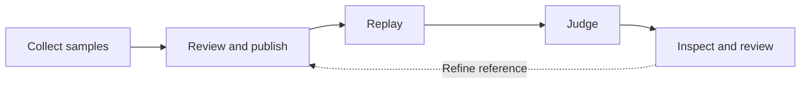

<p align="center">
  
</p>

<h1 align="center">3Chat Agent Eval</h1>

<p align="center">Regression evaluation for customer-facing agents.</p>

<p align="center">
  <strong>English</strong> · <a href="README.zh-CN.md">简体中文</a>
</p>

<p align="center">
  <a href="#quick-start">Quick start</a> · <a href="docs/OPERATIONS.md">Configuration</a> · <a href="docs/EVALUATION_CONFIG_REFERENCE.md">Evaluation guide</a> · <a href="CONTRIBUTING.md">Contributing</a>
</p>

<p align="center">
  <a href="LICENSE"></a>
  <a href="pyproject.toml"></a>
</p>

Compare candidate models on captured requests, validate agent behavior against reviewed scenarios, and trace each verdict to its inputs, evaluation criteria, and execution evidence.

## What you can evaluate

| Mode | Use it to answer | How it works |
| --- | --- | --- |
| **Call Replay** | Does a candidate model improve the same request? | Replay a frozen model call and compare its output with the production baseline through two order-swapped blind judgments. |
| **Turn Replay** | Does the EVAL agent meet the requirements for this turn? | Create a test contact, seed its prior profile, and replay the turn against a reviewed rubric. |

- **Version your benchmarks.** Review reference drafts and publish immutable dataset versions. Corrections create a new version.
- **Inspect the evidence.** Follow dataset hashes, frozen judge settings, per-turn observations, and available model-call traces.
- **Keep human review auditable.** Record human conclusions separately from the original judge results, with revision history.
- **Take results with you.** Export JSON/JSONL evidence bundles with integrity hashes and missing-evidence records.


*Workbench overview. The application UI is currently in Simplified Chinese.*

## Workflow



Turn Replay evaluates independent turns against the EVAL workspace configuration present at execution time. See the [evaluation guide](docs/EVALUATION_CONFIG_REFERENCE.md) for scoring and the [architecture](docs/ARCHITECTURE.md) for execution scope and data handling.

## Quick start

**Requirements:** Python 3.12–3.14, Node.js 20.19+ or 22.12+, npm, and a running PostgreSQL server.

### 1. Install

```bash
git clone https://github.com/3ChatAI-NCT/3chatai-agent-eval.git
cd 3chatai-agent-eval
python3.12 -m venv .venv
source .venv/bin/activate
python -m pip install -e '.[dev]'
cp .env.example .env
createdb agent_eval_dev
npm --prefix frontend ci --ignore-scripts
```

### 2. Configure

Set `EVAL_DATABASE_URL` in `.env` to your PostgreSQL connection string. The template already selects development mode and local storage; service addresses and credentials are left empty. The full variable reference is in [configuration](docs/OPERATIONS.md).

Development mode uses a local identity. Keep the API and web server bound to loopback.

### 3. Start

Run the following from the repository root in three terminals:

```bash
# Terminal 1 — API
source .venv/bin/activate
agent-eval api
```

```bash
# Terminal 2 — worker
source .venv/bin/activate
agent-eval worker
```

```bash
# Terminal 3 — web
npm --prefix frontend run dev
```

Open the [workbench](http://127.0.0.1:5173/agent-eval/). The API applies database migrations at startup; check [readiness](http://127.0.0.1:8080/health/ready) or explore the development [API docs](http://127.0.0.1:8080/docs).

Local startup gives you the UI and API with an empty database. Live collection and evaluation use 3Chat services, a Feishu workspace registry, and SLS. Follow the [integration setup](docs/OPERATIONS.md) to connect your own installation.

## Your first evaluation

Once the integrations are configured:

1. **Register workspaces.** Synchronize the registry and confirm that the source and isolated EVAL workspace pair is active.
2. **Prepare a dataset.** Collect frozen requests for Call Replay, or review conversation references and rubrics for Turn Replay before publishing a dataset version.
3. **Run an evaluation.** Choose a dataset, repeat count, judge configuration, and candidate model or EVAL target. The worker processes queued jobs.
4. **Review the result.** Check execution coverage and per-item evidence, record human review, and export an evidence bundle when the run is complete and blind identities are revealed.

## Documentation

| Guide | Contents |
| --- | --- |
| [Configuration and integrations](docs/OPERATIONS.md) | Environment variables, credentials, external services, and deployment requirements |
| [Evaluation reference](docs/EVALUATION_CONFIG_REFERENCE.md) | Metrics, applicability, scoring, and result interpretation |
| [Architecture](docs/ARCHITECTURE.md) | Components, execution boundaries, evidence, and data handling |
| [Development](docs/DEVELOPMENT.md) | Tests, database setup, lint, build, and project layout |
| [Terminology](CONTEXT.md) · [Prompts](docs/PROMPTS.md) | Domain concepts and versioned evaluation prompts |

Detailed configuration and evaluation references are currently in Chinese.

## Contributing

Bug reports, proposals, and focused pull requests are welcome. Start with the [contribution guide](CONTRIBUTING.md), or open an [issue](https://github.com/3ChatAI-NCT/3chatai-agent-eval/issues). Keep both README versions synchronized and use synthetic data in public examples.

## License

[Apache License 2.0](LICENSE).
