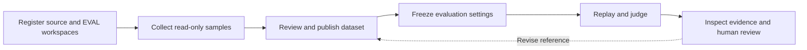

# 3Chat Agent Eval

**Regression evaluation for customer-facing agents, with frozen inputs, versioned rubrics, and reviewable evidence.**

**English** · [简体中文](README.zh-CN.md)

[Configuration](docs/OPERATIONS.md) · [Evaluation reference](docs/EVALUATION_CONFIG_REFERENCE.md) · [Architecture](docs/ARCHITECTURE.md) · [Issues](https://github.com/3ChatAI-NCT/3chatai-agent-eval/issues) · [Apache-2.0](LICENSE)

3Chat Agent Eval connects sample collection, dataset review, isolated replay, LLM-as-Judge scoring, human review, and evidence export. It helps teams investigate which scenarios improved or regressed after a model, prompt, or agent configuration change.

The platform currently integrates with **3Chat services, a Feishu workspace registry, and Alibaba Cloud SLS**. You can start the API and web interface locally, but live collection and evaluation require those external services and your own credentials. A standalone end-to-end demo is not included. The application UI and detailed reference documents are primarily in Simplified Chinese; the language links above switch the README.

## Why use it?

- **Compare candidate models on frozen requests.** Replay a captured model call and compare the candidate with its production baseline using two order-swapped blind judgments.
- **Check agents against reviewed requirements.** Replay individual conversation turns in a separate EVAL workspace and score them against versioned rubrics.
- **Separate semantic judgment from deterministic rules.** Models assess meaning; code handles applicability, schema checks, counting, aggregation, and `pass^k`.
- **Trace a conclusion to its evidence.** Preserve dataset hashes, execution settings, judge prompts and models, available call traces, and append-only human reviews.
- **Export evidence for further analysis.** Download JSON/JSONL evidence bundles with integrity hashes and explicit records of missing evidence.

## Evaluation modes

| | Call Replay | Turn Replay |
| --- | --- | --- |
| Question | Does a candidate model improve this captured request? | Does the current EVAL agent meet reviewed requirements for this turn? |
| Input | Frozen model request and production reference output | Conversation history, current input, reference behavior, profile, and per-turn rubric |
| Execution | Replace only the request's `model`; reject unsupported state-dependent requests | Create a test contact for each turn, seed and verify its prior profile, then send the current input |
| Judgment | Candidate better, tie, baseline better, judge disagreement, or insufficient evidence | Semantic metrics plus deterministic checks, aggregated by turn and session |
| Boundary | A requested tool call does not prove that a tool ran | Independent turn replay does not establish success in a continuous user journey |

The platform does **not** snapshot the complete agent configuration, copy production workspaces, or deploy agents. Turn Replay evaluates the EVAL workspace configuration present at execution time. Execution failures and missing evidence remain visible; they do not count as successful business outcomes. Tool traces are currently diagnostic evidence rather than a component of the Turn Replay pass decision.

## Workflow



Published dataset versions are immutable. Reference corrections produce new versions; human reviews are recorded separately from the original judge results. Run manifests freeze evaluation inputs and scoring settings, while the complete external agent configuration remains outside that snapshot.

## Local quick start

### Prerequisites

- Python **3.12–3.14**.
- Node.js **20.19+ or 22.12+**, and npm, as required by Vite 7.
- A running PostgreSQL server and permission to create a local database. SQLite is not supported.
- Git. No cloud credentials are needed to start the empty local API and UI.

### 1. Install the backend

```bash
git clone https://github.com/3ChatAI-NCT/3chatai-agent-eval.git
cd 3chatai-agent-eval
python3.12 -m venv .venv
source .venv/bin/activate
python -m pip install -e '.[dev]'
cp .env.example .env
createdb agent_eval_dev
```

Use any supported Python interpreter in place of `python3.12`. Run the commands from the repository root. If `.env` already exists, merge the example settings into it instead of overwriting it. Adjust `EVAL_DATABASE_URL` for your local PostgreSQL user, host, and database. All service addresses and credentials in `.env.example` are empty. Set `EVAL_DATABASE_URL` to your own connection string before starting; a local-only example is `postgresql://localhost/agent_eval_dev`. Local object storage uses `.local/objects`.

Minimum local configuration:

| Variable | Local setup |
| --- | --- |
| `EVAL_DATABASE_URL` | Required; enter your own PostgreSQL connection string |
| `EVAL_ENVIRONMENT` | `development` |
| `EVAL_DEV_IDENTITY` | `true`, for loopback-only development |
| `EVAL_STORAGE_BACKEND` | `local` |

The complete variable template is [`.env.example`](.env.example). Required conditions, value formats, and production requirements are documented in [configuration](docs/OPERATIONS.md).

The example enables `EVAL_DEV_IDENTITY=true`, which bypasses authentication for local development. Keep the API and UI bound to loopback. Production requires gateway authentication, an authorized tenant and member list, a HTTPS public origin, and OSS storage.

### 2. Start the API and worker

```bash
# Terminal 1, with the virtual environment activated
agent-eval api
```

```bash
# Terminal 2, from the repository root
source .venv/bin/activate
agent-eval worker
```

Both processes apply Alembic migrations automatically at startup. The worker is required to process queued collection, replay, scoring, and report jobs.

Check [API readiness](http://127.0.0.1:8080/health/ready). In development mode, the API schema is available at [Swagger UI](http://127.0.0.1:8080/docs).

### 3. Start the web interface

```bash
# Terminal 3
npm --prefix frontend ci --ignore-scripts
npm --prefix frontend run dev
```

Open [http://127.0.0.1:5173/agent-eval/](http://127.0.0.1:5173/agent-eval/). Vite proxies `/api/agent-eval` to the local API. A fresh database has no workspaces or datasets; this verifies local startup, not a live evaluation.

## Connect a live installation

| Capability | Required integration |
| --- | --- |
| Workspace registration and access-token resolution | Feishu app and Base registry, with distinct source and EVAL workspaces |
| Request collection and model-call traces | Alibaba Cloud SLS and read-only log-query credentials |
| Judge scoring and AI-assisted rubric drafting | 3Chat model gateway, entitlement service, tenant, and configured model |
| Conversation collection and Turn Replay | 3Chat platform APIs and an isolated EVAL workspace; model-mapping service for execution-model selection |
| Candidate model calls | A supported public HTTPS model endpoint, model name, and API key |
| Production artifact storage | Private Alibaba Cloud OSS bucket and scoped credentials |

Install `python -m pip install -e '.[dev,cloud]'` when using the SLS or OSS integrations. Configure the relevant `EVAL_*`, `SLS_*`, and `ALIBABA_CLOUD_*` variables for your own installation. Gateway, entitlement, mapping, platform, and storage addresses have no preset values; configure them explicitly. Review [settings](src/agent_eval/config.py) and the [deployment reference](docs/OPERATIONS.md) before adapting an installation; production deployment files are not bundled, and all service addresses and secrets belong to your installation.

Candidate API keys also require `EVAL_CREDENTIAL_KEY`, a server-side Fernet key. Generate one with `python -c 'from cryptography.fernet import Fernet; print(Fernet.generate_key().decode())'`, store it in your local `.env` or deployment secret store, and keep it out of source control.

For an installation with those integrations configured:

1. Synchronize the workspace registry and verify the source/EVAL pair is active.
2. Collect Call Replay samples or conversation drafts for Turn Replay.
3. For Turn Replay, review the reference behavior, profile expectations, and rubric before publishing a dataset version. AI-generated drafts require human review.
4. Create an evaluation with a dataset, repeat count, judge settings, and candidate model or EVAL execution target.
5. Run the worker; inspect execution coverage, scoring failures, per-item evidence, and human reviews before interpreting aggregate scores.
6. Export the complete evidence bundle after the run ends and any blind identities are revealed.

Image previews require an explicit `EVAL_MEDIA_ALLOWED_HOSTS` allowlist of exact trusted hostnames. It is empty by default, so unconfigured previews cannot make outbound requests.

## Data handling

Credential filtering is **not personal-data anonymization**. Collected samples, authenticated reports, and exported evidence can retain original business text, phone numbers, email addresses, and image URLs. Restrict access and use synthetic data in public issues, screenshots, fixtures, and examples. Older frozen data may retain earlier masking; upgrades do not reconstruct or rewrite it.

Keep source access read-only and route replay execution to separate test workspaces with test contacts and safe external dependencies. The platform does not provision that isolation for you. Never commit `.env` files, credentials, collected conversations, object storage contents, or report exports.

## Development

```bash
# Unit tests; PostgreSQL integration tests are excluded
python -m pytest -m 'not postgres' --ignore=tests/test_startup_migration.py

# Python lint and frontend production build
ruff check src tests migrations
npm --prefix frontend run build
```

For the full suite, use a **dedicated disposable PostgreSQL database**. The migration tests also require permission to create and drop temporary databases. Do not point these commands at production or at a database containing useful data.

```bash
createdb agent_eval_test
export TEST_DATABASE_URL=postgresql://localhost/agent_eval_test
EVAL_DATABASE_URL="$TEST_DATABASE_URL" python -m alembic upgrade head
python -m pytest
```

Tests use synthetic fixtures and mocked external services. Passing them does not establish that live credentials, integrations, or customer scenarios work.

## Project layout and documentation

| Path | Purpose |
| --- | --- |
| [`frontend/`](frontend/) | React, TypeScript, Vite, and HeroUI workbench |
| [`src/agent_eval/`](src/agent_eval/) | FastAPI, PostgreSQL job queue, workers, registry, and reports |
| [`src/atomic_eval/`](src/atomic_eval/) | Call Replay constraints, pairwise judging, and aggregation |
| [`src/golden_eval/`](src/golden_eval/) | Turn Replay contracts, execution, profiles, and scoring |
| [`prompts/`](prompts/) | Versioned judge and annotation prompts |
| [`migrations/`](migrations/) | Alembic schema migrations |
| [`tests/`](tests/) | Unit and PostgreSQL integration tests |

Detailed references are currently in Chinese: [evaluation metrics](docs/EVALUATION_CONFIG_REFERENCE.md), [architecture](docs/ARCHITECTURE.md), [terminology](CONTEXT.md), and [operations](docs/OPERATIONS.md).

## Contributing and support

See [contribution guidelines](CONTRIBUTING.md) for the change and configuration workflow. Use [GitHub Issues](https://github.com/3ChatAI-NCT/3chatai-agent-eval/issues) for bugs and proposals, and [pull requests](https://github.com/3ChatAI-NCT/3chatai-agent-eval/pulls) for focused changes. Include reproduction steps, expected and actual behavior, relevant versions, and synthetic or redacted evidence. Add regression coverage for behavior changes, run the relevant checks, and keep both README versions synchronized. Do not post credentials or customer data in public reports.

## License

[Apache License 2.0](LICENSE), matching the existing public repository. External services and datasets are not bundled; their access and usage terms apply separately.
