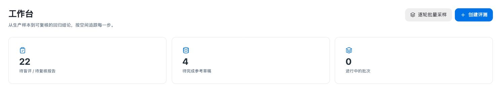
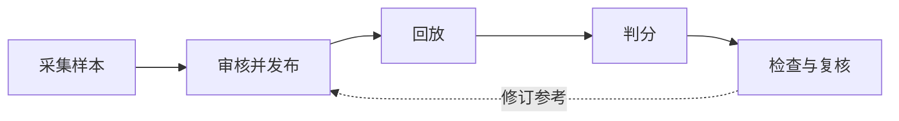

<p align="center">
  
</p>

<h1 align="center">3Chat Agent Eval</h1>

<p align="center">面向客户 Agent 的回归评测平台。</p>

<p align="center">
  <a href="README.md">English</a> · <strong>简体中文</strong>
</p>

<p align="center">
  <a href="#快速开始">快速开始</a> · <a href="docs/OPERATIONS.md">运行配置</a> · <a href="docs/EVALUATION_CONFIG_REFERENCE.md">评估指南</a> · <a href="CONTRIBUTING.md">参与贡献</a>
</p>

<p align="center">
  <a href="LICENSE"></a>
  <a href="pyproject.toml"></a>
</p>

在相同请求上比较候选模型，按已审核的场景验证 Agent 行为，并从每项结论追溯输入、评分依据与执行证据。

## 评测能力

| 策略 | 回答的问题 | 工作方式 |
| --- | --- | --- |
| **Call Replay · 单步回放** | 候选模型在同一请求上是否更好？ | 回放冻结的模型请求，通过两次交换顺序的盲评，将候选输出与生产基线进行比较。 |
| **Turn Replay · 逐轮回放** | EVAL Agent 在这一轮是否满足要求？ | 创建测试联系人、预置上一轮画像，再按已审核的 Rubric 回放和判分。 |

- **版本化评测基准**：审核参考草稿，发布不可变的数据集版本；修订参考标准时生成新版本。
- **逐项追溯证据**：查看数据集哈希、冻结的 Judge 配置、逐轮观测和可用的模型调用链路。
- **保留人工复核记录**：人工结论与原始 Judge 结果分别留存，并记录修订历史。
- **导出完整证据包**：下载 JSON/JSONL 数据、完整性哈希和缺失证据清单，便于进一步分析。



*工作台概览。应用界面目前以简体中文为主。*

## 评测流程



逐轮回放按独立轮次验证执行当时 EVAL 空间的配置。指标口径见[评估指南](docs/EVALUATION_CONFIG_REFERENCE.md)，执行范围与数据处理见[架构说明](docs/ARCHITECTURE.md)。

## 快速开始

**环境要求：** Python 3.12–3.14、Node.js 20.19+ 或 22.12+、npm，以及正在运行的 PostgreSQL 服务。

### 1. 安装

```bash
git clone https://github.com/3ChatAI-NCT/3chatai-agent-eval.git
cd 3chatai-agent-eval
python3.12 -m venv .venv
source .venv/bin/activate
python -m pip install -e '.[dev]'
cp .env.example .env
createdb agent_eval_dev
npm --prefix frontend ci --ignore-scripts
```

### 2. 配置

在 `.env` 中填写自己的 PostgreSQL 连接字符串 `EVAL_DATABASE_URL`。模板已选择开发模式和本地存储，服务地址与凭据均留空。完整变量说明见[运行配置](docs/OPERATIONS.md)。

开发模式使用本地身份，API 和前端应只监听回环地址。

### 3. 启动

从仓库根目录，在三个终端中分别执行：

```bash
# 终端 1 — API
source .venv/bin/activate
agent-eval api
```

```bash
# 终端 2 — Worker
source .venv/bin/activate
agent-eval worker
```

```bash
# 终端 3 — 前端
npm --prefix frontend run dev
```

打开[工作台](http://127.0.0.1:5173/agent-eval/)。API 启动时会自动迁移数据库，可通过[就绪检查](http://127.0.0.1:8080/health/ready)确认启动，或查看开发模式下的[接口文档](http://127.0.0.1:8080/docs)。

本地启动后可访问工作台和 API，数据库初始为空。真实采集与评测依赖 3Chat 服务、飞书空间台账和 SLS，请按[接入说明](docs/OPERATIONS.md)配置自己的环境。

## 完成首次评测

完成外部系统接入后：

1. **登记评测空间**：同步台账，确认来源空间与独立 EVAL 空间配对且状态可用。
2. **准备数据集**：单步回放采集冻结请求；逐轮回放需审核会话参考和 Rubric，再发布数据集版本。
3. **创建评测**：选择数据集、重复次数、Judge 配置，以及候选模型或 EVAL 执行目标，由 Worker 消费任务。
4. **复核结果**：检查执行覆盖和逐项证据，记录人工结论；评测结束且盲评身份揭晓后，导出完整证据包。

## 文档

| 文档 | 内容 |
| --- | --- |
| [运行配置与接入](docs/OPERATIONS.md) | 环境变量、凭据、外部服务及部署要求 |
| [评估配置](docs/EVALUATION_CONFIG_REFERENCE.md) | 指标、适用条件、判分与结果解释 |
| [架构说明](docs/ARCHITECTURE.md) | 组件、执行边界、证据与数据处理 |
| [开发指南](docs/DEVELOPMENT.md) | 测试、数据库准备、静态检查、构建与目录结构 |
| [术语表](CONTEXT.md) · [Prompt 约定](docs/PROMPTS.md) | 业务概念与版本化评测提示词 |

详细配置和评估参考文档目前以中文为主。

## 参与贡献

欢迎提交问题、建议和范围清晰的 Pull Request。请先阅读[贡献指南](CONTRIBUTING.md)，或通过 [Issues](https://github.com/3ChatAI-NCT/3chatai-agent-eval/issues)反馈。修改文档时同步维护中英文 README，公开示例统一使用虚构数据。

## 许可证

[Apache License 2.0](LICENSE)。
