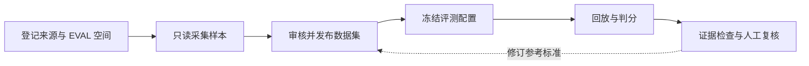

# 3Chat Agent Eval

**面向客户 Agent 的回归评测平台：冻结输入、版本化评测标准，让结论有据可查。**

[English](README.md) · **简体中文**

[运行配置](docs/OPERATIONS.md) · [评估配置](docs/EVALUATION_CONFIG_REFERENCE.md) · [架构](docs/ARCHITECTURE.md) · [问题反馈](https://github.com/3ChatAI-NCT/3chatai-agent-eval/issues) · [Apache-2.0](LICENSE)

3Chat Agent Eval 将样本采集、数据集审核、隔离回放、LLM-as-Judge 判分、人工复核与证据导出串成一条工作流，帮助团队定位模型、Prompt 或 Agent 配置变更后，哪些场景改善、哪些场景退化。

当前平台依赖 **3Chat 服务、飞书空间台账和阿里云 SLS**。本地可以启动 API 与工作台；真实采集和评测需要接入这些外部服务并提供自己的凭据。仓库暂未提供独立运行的端到端演示。应用界面和详细参考文档目前以简体中文为主；上方语言链接仅切换 README。

## 核心能力

- **在冻结请求上比较候选模型**：回放已采集的模型请求，通过两次交换顺序的盲评比较候选输出与生产基线。
- **按已审核的业务标准检查 Agent**：在独立 EVAL 空间逐轮回放会话，依据版本化 Rubric 判分。
- **语义判断与确定性规则分离**：模型判断含义；适用性、协议检查、计数、聚合与 `pass^k` 交给代码。
- **从结论追溯证据**：保留数据集哈希、执行配置、Judge Prompt 与模型、可用调用链路及追加式人工复核记录。
- **导出完整证据包**：提供 JSON/JSONL 数据、完整性哈希，并明确列出缺失的证据。

## 两种评测策略

| | Call Replay · 单步回放 | Turn Replay · 逐轮回放 |
| --- | --- | --- |
| 回答的问题 | 候选模型在同一冻结请求上是否更好？ | 当前 EVAL Agent 在该轮是否满足已审核要求？ |
| 输入 | 冻结的模型请求与生产参考输出 | 会话历史、当前输入、参考行为、画像与逐轮 Rubric |
| 执行方式 | 仅替换请求中的 `model`；拒绝不支持的状态依赖请求 | 每轮新建测试联系人，预置并核验上一轮画像，再发送当前输入 |
| 判分结果 | 候选更优、持平、基线更优、评审分歧或证据不足 | 语义指标与代码校验，聚合到 Turn 和 Session |
| 能力边界 | 提出工具调用不能证明工具已执行 | 独立逐轮回放不能证明连续用户旅程成功 |

平台目前**不冻结完整 Agent 配置、不复制生产空间，也不部署 Agent**。逐轮回放评测的是执行当时 EVAL 空间的实际配置。执行失败和证据缺失会单独呈现，不能算作业务成功；工具链路目前仅供诊断，不参与逐轮回放的通过判定。

## 评测工作流



已发布的数据集版本不可变。修订参考标准会生成新版本，人工复核与原始 Judge 结论分别留存。运行 manifest 冻结评测输入和判分配置，完整的外部 Agent 配置不在此快照范围内。

## 本地快速开始

### 环境要求

- Python **3.12–3.14**。
- Node.js **20.19+ 或 22.12+**，以及 npm，符合 Vite 7 要求。
- 正在运行的 PostgreSQL 服务，以及创建本地数据库的权限。不支持 SQLite。
- Git。启动空的本地 API 和工作台不需要云端凭据。

### 1. 安装后端

```bash
git clone https://github.com/3ChatAI-NCT/3chatai-agent-eval.git
cd 3chatai-agent-eval
python3.12 -m venv .venv
source .venv/bin/activate
python -m pip install -e '.[dev]'
cp .env.example .env
createdb agent_eval_dev
```

可用其他受支持的 Python 版本替代 `python3.12`。所有命令均从仓库根目录执行；若已有 `.env`，请合并示例配置，不要覆盖。按本机 PostgreSQL 的用户、地址和数据库调整 `EVAL_DATABASE_URL`；`.env.example` 中所有服务地址与凭据均留空，启动前须填写自己的连接字符串；仅本地使用的示例为 `postgresql://localhost/agent_eval_dev`。对象存储使用本地 `.local/objects`。

最少需要确认的本地配置：

| 变量 | 本地设置 |
| --- | --- |
| `EVAL_DATABASE_URL` | 必填，填写自己的 PostgreSQL 连接字符串 |
| `EVAL_ENVIRONMENT` | `development` |
| `EVAL_DEV_IDENTITY` | `true`，仅用于回环地址开发 |
| `EVAL_STORAGE_BACKEND` | `local` |

完整变量模板见 [`.env.example`](.env.example)，各项必填条件、格式与生产要求见[运行配置](docs/OPERATIONS.md)。

示例启用 `EVAL_DEV_IDENTITY=true`，会跳过本地登录认证；API 和前端均应只监听回环地址。生产部署需要网关鉴权、授权租户与成员名单、HTTPS 公网 Origin，以及 OSS 存储。

### 2. 启动 API 和 Worker

```bash
# 终端 1，先激活虚拟环境
agent-eval api
```

```bash
# 终端 2，从仓库根目录执行
source .venv/bin/activate
agent-eval worker
```

两个进程启动时都会自动执行 Alembic 迁移。Worker 负责消费采集、回放、判分和报告队列任务。

通过 [API 就绪检查](http://127.0.0.1:8080/health/ready) 验证启动；开发模式下可访问 [Swagger UI](http://127.0.0.1:8080/docs) 查看接口。

### 3. 启动工作台

```bash
# 终端 3
npm --prefix frontend ci --ignore-scripts
npm --prefix frontend run dev
```

打开 [http://127.0.0.1:5173/agent-eval/](http://127.0.0.1:5173/agent-eval/)。Vite 将 `/api/agent-eval` 代理到本地 API。全新数据库没有空间和数据集；此时仅验证本地启动，尚未完成真实评测。

## 接入真实评测环境

| 能力 | 所需外部系统 |
| --- | --- |
| 空间登记与 AccessToken 解析 | 飞书应用及多维表格台账；来源空间与 EVAL 空间必须独立 |
| 请求采集与模型调用链路 | 阿里云 SLS 和只读日志查询凭据 |
| Judge 判分与 AI 起草 Rubric | 3Chat 模型网关、entitlement 服务、租户及配置好的模型 |
| 会话采集与逐轮回放 | 3Chat 平台 API、隔离 EVAL 空间；选择执行模型还依赖模型映射服务 |
| 候选模型调用 | 受支持的公网 HTTPS 模型接口、模型名称和 API Key |
| 生产证据存储 | 阿里云私有 OSS Bucket 与限定权限的凭据 |

使用 SLS 或 OSS 时执行 `python -m pip install -e '.[dev,cloud]'` 安装可选依赖，并为自己的环境配置相关 `EVAL_*`、`SLS_*` 和 `ALIBABA_CLOUD_*` 变量。网关、授权、模型映射、平台和存储服务均不预设地址，需显式配置。接入前请核对[配置定义](src/agent_eval/config.py)与[部署参考](docs/OPERATIONS.md)；仓库不附带现用生产部署清单，服务地址与秘密均由安装者自己的环境提供。

使用候选模型 API Key 还需设置服务端 Fernet 密钥 `EVAL_CREDENTIAL_KEY`。可执行 `python -c 'from cryptography.fernet import Fernet; print(Fernet.generate_key().decode())'` 生成，保存到本地 `.env` 或部署密钥存储中，不要纳入版本控制。

完成上述接入后，首次评测流程为：

1. 同步空间台账，确认来源与 EVAL 空间配对且状态可用。
2. 采集单步回放样本，或用于逐轮回放的会话草稿。
3. 逐轮回放需人工核对参考行为、画像要求和 Rubric，再发布数据集版本；AI 起草不能替代人工审核。
4. 选择数据集、重复次数、Judge 配置，以及候选模型或 EVAL 执行目标，创建评测。
5. 启动 Worker，先检查执行覆盖、判分失败和逐条证据，再结合人工复核解释汇总指标。
6. 评测结束且盲评身份已揭晓后，导出完整证据包。

图片预览需要通过 `EVAL_MEDIA_ALLOWED_HOSTS` 显式配置可信域名白名单，仅支持精确域名。默认值为空，未配置时不会向附件地址发起出站请求。

## 数据处理

凭据过滤**不等于个人信息匿名化**。采集样本、鉴权后的报告和导出证据可能保留原始业务正文、手机号、邮箱及图片 URL。请限制访问范围，在公开 Issue、截图、测试数据和示例中使用虚构数据。旧冻结数据可能仍含此前的掩码，升级不会还原或改写。

来源访问应保持只读，回放应使用独立测试空间、测试联系人和安全的外部依赖。平台不会替你创建这些隔离条件。不要提交 `.env`、凭据、采集会话、对象存储内容或报告导出文件。

## 开发与验证

```bash
# 单元测试；不包含 PostgreSQL 集成测试
python -m pytest -m 'not postgres' --ignore=tests/test_startup_migration.py

# Python 静态检查与前端生产构建
ruff check src tests migrations
npm --prefix frontend run build
```

完整测试需要**独立且可丢弃的 PostgreSQL 测试库**；迁移测试还需要创建、删除临时数据库的权限。不要指向生产库或任何含有重要数据的数据库。

```bash
createdb agent_eval_test
export TEST_DATABASE_URL=postgresql://localhost/agent_eval_test
EVAL_DATABASE_URL="$TEST_DATABASE_URL" python -m alembic upgrade head
python -m pytest
```

测试使用虚构样本与模拟外部服务。测试通过不能证明真实凭据、外部接入或客户业务场景已验证成功。

## 项目结构与文档

| 路径 | 职责 |
| --- | --- |
| [`frontend/`](frontend/) | React、TypeScript、Vite 与 HeroUI 工作台 |
| [`src/agent_eval/`](src/agent_eval/) | FastAPI、PostgreSQL 任务队列、Worker、台账与报告 |
| [`src/atomic_eval/`](src/atomic_eval/) | 单步回放约束、成对判分与聚合 |
| [`src/golden_eval/`](src/golden_eval/) | 逐轮回放合同、执行、画像与评分 |
| [`prompts/`](prompts/) | 版本化 Judge 与标注 Prompt |
| [`migrations/`](migrations/) | Alembic 数据库迁移 |
| [`tests/`](tests/) | 单元测试与 PostgreSQL 集成测试 |

详细参考：[评估指标](docs/EVALUATION_CONFIG_REFERENCE.md)、[架构](docs/ARCHITECTURE.md)、[术语表](CONTEXT.md)及[运行手册](docs/OPERATIONS.md)。

## 贡献与支持

修改与配置维护流程见[贡献指南](CONTRIBUTING.md)。通过 [GitHub Issues](https://github.com/3ChatAI-NCT/3chatai-agent-eval/issues) 提交问题与建议，通过 [Pull Requests](https://github.com/3ChatAI-NCT/3chatai-agent-eval/pulls) 提交范围清晰的修改。请提供复现步骤、预期与实际行为、相关版本和虚构或脱敏后的证据。行为变更应包含回归验证，提交前运行相关检查，并同步维护中英文 README。不要在公开报告中附带凭据或客户数据。

## 许可证

采用 [Apache License 2.0](LICENSE)，与现有公开仓库一致。外部服务及数据集不随仓库分发，其访问和使用另受各自条款约束。
