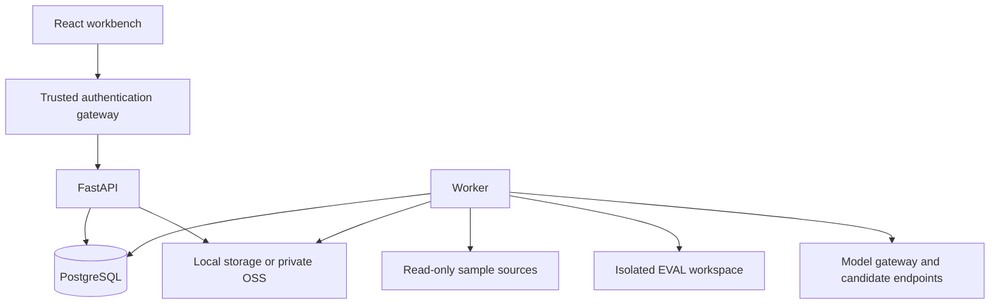

# 平台架构与业务合同

## 评测边界

平台关联只读来源空间和独立 EVAL 空间，不复制生产 Workspace，也不部署或完整冻结 Agent 配置。安装者负责准备测试联系人、模拟外部依赖和隔离的业务写入链路。来源与 EVAL 访问凭据必须独立，按运行任务在服务端解析，不进入公开示例。

| 策略 | 执行对象 | 结论范围 |
| --- | --- | --- |
| Call Replay · 单步回放 | 冻结模型请求，只替换 `model` | 相同请求下的相对输出质量；工具调用提议不证明实际执行 |
| Turn Replay · 逐轮回放 | 冻结历史、预置画像和当前输入，每轮独立创建测试联系人 | 已审核条件下的逐轮行为；不能等同于连续用户旅程成功 |

参考答案、Rubric 和 Judge Prompt 不传给被测 Agent。模型负责语义判断，代码负责适用性、协议检查、计数、聚合及 `pass^k`。执行错误、投递未知与证据缺失不能合并为通过。

## 组件

- `src/agent_eval/`：API、鉴权、任务编排、空间台账、存储与报告。
- `src/atomic_eval/`：单步回放约束、交换顺序的成对判分与聚合。
- `src/golden_eval/`：逐轮回放合同、画像、执行和语义判分。
- PostgreSQL：空间、版本化数据集、运行 manifest、租约队列、事件、复核和审计。
- 本地对象存储或私有 OSS：采集快照、冻结执行证据和报告包；以内容哈希校验完整性。

API 与 Worker 启动时自动执行 Alembic 迁移，使用数据库咨询锁串行化并发迁移。Worker 持有效租约才能回写结果；外部请求超时保留 `uncertain`，不会静默重发可能具有副作用的操作。

## 版本与证据

已发布数据集不可变。参考修订产生新版本；运行 manifest 冻结数据集哈希、Judge Prompt 正文和版本、Judge 模型、执行配置及引擎指纹。它不包含完整的外部 Agent 配置快照。

人工复核与原始 Judge 结果分别保存，并追加修订记录。证据包按实际采集覆盖情况导出，包含完整性哈希和缺失证据清单；模型调用尚未采集、证据过期或投递状态未知时，不补造成功结果。

## 网络与数据访问

业务 API 路径为 `/api/agent-eval/v1/`，页面路径为 `/agent-eval/`。生产环境需要可信认证网关：移除客户端传入的 `tenant_id`、`staff_id` 及网关共享口令头，再注入已认证身份。API 必须通过网络访问控制隔离，并配置 `EVAL_GATEWAY_TOKEN`；写请求校验 `EVAL_PUBLIC_ORIGIN`。

开发身份仅供回环地址上的本地开发。服务地址与所有凭据在公开配置中均为空，由安装者通过环境变量或密钥存储注入。

图片预览只接受数据集已保存附件，不接受任意浏览器源 URL。`EVAL_MEDIA_ALLOWED_HOSTS` 是逗号分隔的精确域名白名单，默认为空，空值禁止出站图片读取。预览只允许 HTTPS 标准端口，不发送 URL 中的用户密码、不跟随重定向，并限制响应类型和大小。仅配置由安装者控制、解析到受信任公网媒体服务的域名，结合出站网络限制保护内部服务。

## 留存与隐私

凭据过滤不等于个人信息匿名化。样本、鉴权后的报告和证据包可能保留业务正文、联系方式和原始图片 URL。公开截图、测试数据、Issue 和报告必须使用虚构材料；仓库不附带真实会话、客户案例或凭据。

普通执行证据及可清理原始快照保留 30 天，逐轮模型调用正文保留 60 天，报告产物保留 180 天，已发布数据集至少保留 730 天；依赖关系和待复核状态会延长保留。清理默认 dry-run，实际删除需显式 `--apply`。归档不等于删除；永久删除还需满足状态、复核与来源依赖条件。

详细配置见[运行配置](OPERATIONS.md)，指标口径见[评估配置](EVALUATION_CONFIG_REFERENCE.md)。
